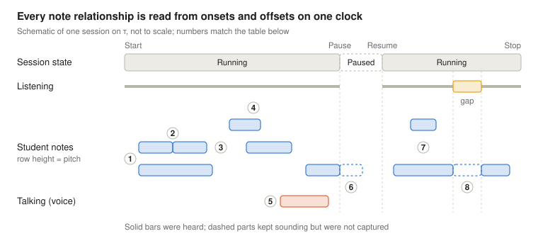

# Practice Session: Atomic Variables

Oct 12, 2026 · @Jack

## Summary

A practice session reduces to 14 primary variables: 3 frame the session in time and 11 describe the sound, six of them per sound event. Everything else, including play time, efficiency, tempo, chords and articulation, is computed from these 14.

- **One clock.** Every variable is placed by τ, seconds since Start on a monotonic clock. Only the Start instant carries a wall-clock time.
- **Relationships come free.** Order, overlap, simultaneity and rests between notes follow from each event's onset and offset, so none of them is stored.
- **Two things timing can't tell.** Which source made a sound, and who played it, must be recorded. They are what keeps talking, a teacher's demo or a backing track out of play time.

## Scope and what counts as atomic

A variable is primary when no other variable in the model can compute it. Where two carry the same information, only one is kept: onset and offset are primary, so duration is not.

Sound is modelled in two layers:

1. **Raw signal.** The recorded waveform is the only strictly underivable sound data; every sound variable is ultimately estimated from it.
2. **Event model.** What a detector reports: sources and discrete sound events with their attributes. These are estimated from the waveform but independent of one another, and they are what the app stores and reasons about.

The event model is complete when it can resynthesise what was heard: every event rendered from its attributes, passed through the room, plus background noise.

```latex
x(\tau) \approx h_{\text{room}} * \sum_{e} s_e\left(\tau;\ f_{0,e},\ a_e,\ S_e,\ [\tau_{\text{on},e},\ \tau_{\text{off},e}]\right) + n(\tau)
```

**In scope:** everything between Start and Stop — control actions, capture interruptions, the room and everything heard in it.

**Out of scope:** settings and identities that outlive a session — theme, visualisation mode, practice goal, tuning reference, timing tolerances, device and microphone, sample rate, student profile, instructor and parent links. Session id and owner are keys, not variables.

**Dropped deliberately:** signal phase (inaudible, and the one lossy step between the two layers) and spatial position (one microphone cannot observe it).

## One clock

Every variable hangs off one time base, τ: seconds since Start on a monotonic clock. Start is τ = 0, and its wall-clock instant t₀ is the only absolute time stored.

- **Monotonic, not wall-clock.** Clock sync, daylight-saving shifts or a time-zone change mid-session cannot reorder or stretch events.
- **Runs through pauses.** Paused spans stay visible as stretches of τ, so control actions, capture gaps and sound share one timeline. An active-time clock that skips pauses is derived from it.
- **Continuous variables are sampled on τ.** Pitch, loudness, spectrum and noise floor are stored as frames at a fixed hop (10 ms is typical for pitch tracking). The hop is a representation choice, not a variable.

## Primary variables: session frame

Three variables say when the session ran and when it could hear. Session state, active time and paused time are all computed from them.

| # | Variable | Time character | Value | Notes |
| --- | --- | --- | --- | --- |
| P1 | Session anchor t₀ | One absolute instant | UTC timestamp of Start | The only wall-clock value; maps τ back to real time |
| P2 | Control actions | Instants | Ordered list of (type, τ), type ∈ {Start, Pause, Resume, Stop} | Must follow Start (Pause Resume)\* \[Pause\] Stop |
| P3 | Capture gaps | Intervals | List of \[τ\_from, τ\_to) with a cause (call, app in background, microphone lost) | Time inside Running when nothing was recorded; not derivable from P2 |

P3 matters because the app cannot tell silence from deafness otherwise. A minute with no notes and a minute with no microphone look identical in the sound variables.

## Primary variables: the sound

Eleven variables describe everything heard: the raw signal, the room it was heard in, who or what made each sound, and each sound event's timing, pitch, loudness and tone colour.

| # | Variable | Belongs to | Time character | Value | Notes |
| --- | --- | --- | --- | --- | --- |
| P4 | Waveform x(τ) | Session | Continuous signal | Pressure samples per microphone channel | Ground truth; P5–P14 are estimated from it |
| P5 | Noise floor N(f, τ) | Session | Continuous signal | Background level per frequency band | Hum, traffic, fans; spans the whole session |
| P6 | Room response | Session | Quasi-constant | Reverberation time or impulse response | Changes only if the student moves rooms |
| P7 | Source class | Source | Constant | Specific instrument, human voice, metronome, recorded playback, other | One record per distinct source heard |
| P8 | Performer | Source | Constant | Student, another person, device | A teacher's violin sounds like the student's, so timbre cannot decide this |
| P9 | Source reference | Event | Constant | Which P7/P8 record produced it | Ties each event to a source |
| P10 | Onset τ\_on | Event | Instant | Seconds | Start of the excitation |
| P11 | Offset τ\_off | Event | Instant | Seconds | End of the source's own sound, before the room's tail (P6 holds the tail) |
| P12 | Pitch trajectory f₀(τ) | Event | Signal on \[τ\_on, τ\_off\] | Hz per frame; absent if unpitched | Holds vibrato, bends and glides, not just one note number |
| P13 | Amplitude envelope a(τ) | Event | Signal on \[τ\_on, τ\_off\] | Level per frame | Holds attack, swell, accent and decay |
| P14 | Spectral shape S(f, τ) | Event | Signal on \[τ\_on, τ\_off\] | Partial balance, inharmonicity, noise and transient content, normalised for pitch and level | Tone colour and technique: bow noise, breath, pizzicato, mute |

**What counts as one event.** An event is one continuous excitation at one target pitch: a struck key, a bow stroke, a tongued note, a drum hit, a word. A new event starts at a re-attack or a discrete pitch change, so a slur becomes two events that meet. Vibrato and continuous glides stay inside one event's f₀(τ).

**Polyphony needs no extra variable.** A chord is several events with near-equal onsets; a double stop is two events from one source.

**Non-music events use the same shape.** Speech, a door, a dog are events from non-instrument sources. Speech content is carried by S(f, τ), so for privacy the app can keep only class, onset, offset and level for those events.

## Temporal relationships

Only one relationship needs storing: which source each event came from. Order, overlap, simultaneity, rests and gating by Pause are all computed from endpoints on τ.



Notes relate through their onsets and offsets alone. The Pause and the capture gap cut what was heard, not what was played.

| # | Relation | Endpoint test (events A, B) | Musical reading |
| --- | --- | --- | --- |
| 1 | A starts B | A.on = B.on, A.off < B.off | Chord tones released at different times |
| 2 | A meets B | A.off = B.on | Legato or slur, no gap |
| 3 | A before B | A.off < B.on | Separated notes; the gap is a rest or detached articulation |
| 4 | A overlaps B | A.on < B.on < A.off < B.off | Overlapping legato, pedal or resonance blur |
| 5 | Overlap across sources | Any overlap, different source (P9) | Not a musical relation; talking stays out of play time |
| 6 | Cut by Pause | Event spans a Pause | Observed offset is the Pause, not the true end (censored) |
| 7 | A during B | B.on < A.on, A.off < B.off | A moving line over a held note |
| 8 | Cut by capture gap | Event spans a gap | Event splits in two; the hidden part is unknown, not silent |

The other interval relations follow the same way: finishes (released together), equals (a block chord) and the inverses. Every = means within a simultaneity tolerance, since two fingers never land at the same millisecond.

**Gating.** Each level nests in the one before: session, Running spans (P2), listening spans (minus P3), then the counted parts of events. Sound during a Pause is never captured, so it never enters.

**Within an event.** f₀(τ), a(τ) and S(f, τ) exist only on \[τ\_on, τ\_off\] and share τ. They co-vary physically, as a plucked string sags in pitch and dulls while it decays, but none computes another.

**Within a source.** A monophonic source such as a flute, trumpet or voice cannot overlap itself, so overlap there flags a detection error. Piano and guitar notes overlap naturally as they ring, which is why τ\_off excludes the room's tail.

**What timing cannot tell.** Endpoints don't say which source sounded (P9), whether two adjacent sounds are one note or two (the event rule), which voice a note belongs to (inferred), or why it was played.

Invariants every session must satisfy:

- Control actions are strictly ordered, follow the grammar, and Start is τ = 0.
- Every capture gap lies inside a Running span.
- Every event has τ\_on < τ\_off, and its f₀, a and S are defined only between them.
- Every event points to an existing source.

## Derived variables

Everything below is computable from P1–P14, sometimes with a setting from outside the session, so none of it needs storing.

| Derived variable | Computed from | Rule |
| --- | --- | --- |
| Session state at τ | P2 | Last control action at or before τ |
| Elapsed, active and paused time; pause count | P2 | Lengths of the Stop span, Running spans and Paused spans |
| Listening time | P2, P3 | Running spans minus capture gaps |
| Play time | P2, P3, P8–P11 | Union of the student's music event intervals, short gaps bridged, inside listening time (formula below) |
| Efficiency | Play time, active time | Play time ÷ active time |
| Goal progress, trophy | Play time + practice goal (setting) | Play time against the goal |
| Music / speech / noise / silence at τ | P7, P9–P11 | Which source classes are sounding at τ; silence = none |
| Duration | P10, P11 | τ\_off − τ\_on |
| Note name, octave, intonation in cents | P12 + tuning reference (setting) | Median f₀ to nearest semitone; the remainder is intonation |
| Vibrato rate and depth, bends, glissando | P12 | Shape of f₀(τ) |
| Dynamic level, accents, swells, attack and decay times | P13 | Shape of a(τ) |
| Brightness, tone quality, technique | P14 | Features of S(f, τ) |
| Articulation (legato, detached, staccato) | P10, P11 of neighbours + P13 | Gap or overlap to the next event, plus attack shape |
| Rests | P9–P11 | Gaps between consecutive student events |
| Inter-onset intervals, tempo, beat, meter, rubato, steadiness | P10 | Spacing of consecutive onsets |
| Chords | P9, P10, P12 | Events with onsets inside a simultaneity tolerance |
| Melodic intervals, contour, key, harmony | P10, P12 | Pitch order and pitch sets over time |
| Range (lowest and highest note) | P12 | Extremes of nominal pitch; feeds the Classic piano-roll keyboard |
| Voices or streams | P10–P12 | Inferred by grouping pitch and timing; ambiguous, so never primary |
| Phrases, repeats, retakes | P10–P14 | Gap structure and self-similarity |
| Signal-to-noise ratio | P5, P13 | Event level against the noise floor |

Play time must be a union, not a sum: a three-note chord would otherwise count three times. With E the student's music events, L the listening set and δ the gap tolerance:

```latex
T_{\text{play}} = \left|\ \operatorname{close}_{\delta}\!\left(\bigcup_{e \in E} [\tau_{\text{on},e},\ \tau_{\text{off},e}]\right) \cap L\ \right|
```

Here close\_δ fills any gap shorter than δ, so a rest inside a phrase still counts as playing.

## Data shape and open decisions

The 14 variables fit one session record with two child lists, sources and events. No relationship between events is stored; it is all recomputed from τ.

```ts
type Seconds = number; // τ: seconds since Start, monotonic

interface Track<T> { start: Seconds; hop: Seconds; values: T[] } // frames on τ

interface Session {
  id: string; ownerId: string;                                  // keys, not variables
  t0: string;                                                   // P1  ISO 8601 UTC
  control: { type: 'start' | 'pause' | 'resume' | 'stop'; t: Seconds }[]; // P2
  captureGaps: { from: Seconds; to: Seconds; cause?: string }[];         // P3
  audioRef?: string;                                            // P4  if raw audio is kept
  noiseFloor: Track<number[]>;                                  // P5  band levels per frame
  room: { rt60?: Seconds; impulseRef?: string };                // P6
  sources: Source[];
  events: SoundEvent[];
}

interface Source {
  id: string;
  class: string;                                                // P7  e.g. 'violin', 'voice', 'metronome'
  performer: 'student' | 'other-person' | 'device';             // P8
}

interface SoundEvent {
  source: string;                                               // P9
  on: Seconds; off: Seconds;                                    // P10, P11
  f0?: Track<number>;                                           // P12 Hz; absent if unpitched
  amp: Track<number>;                                           // P13
  spectrum?: Track<number[]>;                                   // P14 omitted for speech
}
```

Four decisions the model leaves open:

- **Event boundaries.** The default splits at a re-attack or a discrete pitch change. Portamento between two notes could go either way; pick one rule and apply it to every instrument.
- **Keeping raw audio.** Storing P4 keeps every derived value re-computable as detectors improve. Dropping it shrinks storage and keeps speech private.
- **How P8 gets its value.** Timbre cannot separate the student from a teacher on the same instrument. It may need a tag from the student, or an assumption that the declared instrument is the student.
- **Tolerances.** The simultaneity window and the gap tolerance δ are settings, but play time, chords, articulation and rests all change with them.
